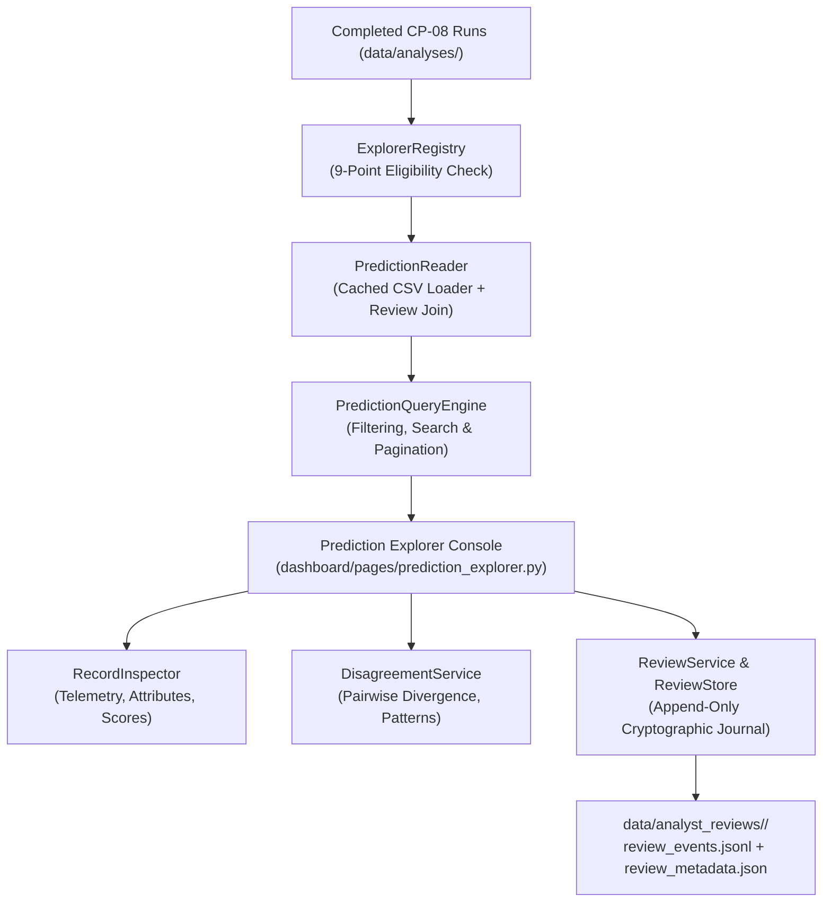

# Checkpoint CP-09 — Prediction Explorer & Analyst Review

**Subsystem:** Prediction Explorer & Human-in-the-Loop Analyst Review  
**Milestone:** CP-09  
**Status:** Completed & Cryptographically Verified  
**Baseline Commit:** `1e44e60`  
**Test Suite:** 218 / 218 tests passing (100% pass rate, 0 regressions)  

---

## 1. Subsystem Architecture

Checkpoint CP-09 introduces a human-in-the-loop forensic exploration and review interface to the AI-Powered Network Intrusion Detection System (NIDS). The subsystem operates as a strictly read-only consumer of completed CP-08 detection runs, providing security analysts with forensic record inspection, cross-model consensus analysis, and an append-only, tamper-evident audit journal.

---

## 2. Core Subsystem Modules (`src/explorer/`)

| Module | Core Responsibility |
|---|---|
| `review_models.py` | Dataclasses for `ReviewEvent`, `ReviewSummary`, and `AnalystDisposition` enums. |
| `review_store.py` | Append-only event persistence in `data/analyst_reviews/`, per-run locking, and cryptographic hash chaining. |
| `explorer_registry.py` | Scans `data/analyses/` and applies the 9-point verification check for exploration eligibility. |
| `prediction_reader.py` | Safely loads and caches `predictions.csv` with path-traversal protection and joins live review state. |
| `prediction_query.py` | Bounded pagination, multi-attribute filtering, substring search, and triage sorting. |
| `record_inspector.py` | Forensic inspection of individual network flows, retrieving raw attributes and model score semantics. |
| `disagreement_service.py` | Computes consensus rates, pairwise match matrices, and divergence patterns without meta-ensembles. |
| `review_service.py` | High-level orchestrator for review submissions, summary metrics, and audit integrity verification. |

---

## 3. Strict Project Invariants & Safeguards

1. **Exactly Three Authorized Algorithms:**  
   Inference outputs originate exclusively from Support Vector Machine (`LinearSVC`), Multilayer Perceptron (`MLPClassifier`), and Decision Tree (`DecisionTreeClassifier`). No 4th ensemble, voting meta-model, or heuristic classifier is introduced.
2. **Read-Only Detection Artifact Consumer:**  
   The explorer strictly consumes completed CP-08 artifacts (`predictions.csv`, `model_comparison.csv`, `run_manifest.json`). It performs **zero** model training, refitting, or new inference runs.
3. **Zero Mutation of Detection Artifacts:**  
   Analyst reviews are persisted separately under `data/analyst_reviews/<detection_run_id>/`. Detection artifacts and run manifests are cryptographically verified to have identical SHA-256 hashes before and after review actions.
4. **Human Review Is Distinct from Model Predictions:**  
   A model prediction is not a confirmed incident. An analyst disposition is an explicit human-initiated assessment.
5. **No Synthetic or Fabricated Statistics:**  
   All metrics, charts, tables, and review progress percentages are computed from verified files on disk.

---

## 4. Detection Run Discovery (9-Point Eligibility Gate)

Before any run can be inspected, `ExplorerRegistry` enforces a strict 9-point verification gate:

1. **Directory Existence:** Run directory exists in `data/analyses/`.
2. **Manifest Integrity:** `run_manifest.json` exists and parses cleanly.
3. **Eligible Status:** Manifest status is `Completed` or `Completed with Warnings`.
4. **Fixture Isolation:** `is_test_fixture == False` and `run_type == "production"`.
5. **Artifact Presence:** `predictions.csv` exists on disk.
6. **Cryptographic Integrity:** SHA-256 of `predictions.csv` matches manifest `output_artifacts`.
7. **Model Metadata:** Complete inference metadata exists in `models` dictionary.
8. **Provenance Lineage:** Source dataset ID, filename, and SHA-256 recorded.
9. **Schema Compatibility:** Required `source_row_index` column present.

---

## 5. Analyst Review Workflow & Allowed Dispositions

Analysts evaluate individual flows and assign one of exactly five authorized human dispositions:

1. **`Potentially Malicious`:** Suspicious flow characteristics warranting SOC alert escalation.
2. **`Likely Benign`:** Expected enterprise or background network traffic.
3. **`False Positive`:** Benign traffic misclassified by model estimators.
4. **`Needs Further Investigation`:** Inconclusive flow requiring deep PCAP or host forensic correlation.
5. **`Inconclusive`:** Insufficient network context or ambiguous telemetry.

### Review Persistence & Cryptographic Hash Chaining

Reviews are appended as immutable events in `data/analyst_reviews/<detection_run_id>/review_events.jsonl`.  
Each event calculates its canonical SHA-256 hash chaining to the preceding event:

$$H_i = \text{SHA-256}\Big(\text{Event}_i \,\|\, H_{i-1}\Big)$$

Altering any previous event line or deleting records immediately invalidates the hash chain and raises a tamper alert during integrity verification.

---

## 6. Model Score Semantics & Decision Transparency

The explorer transparently communicates algorithm-specific score semantics:

- **Support Vector Machine (LinearSVC):** Signed Euclidean distance to separating hyperplane (`decision_function`). Multiclass assignment based on highest margin. Scores are uncalibrated distances, not probabilities.
- **Multilayer Perceptron (MLPClassifier):** Softmax activation output. Heuristic uncalibrated activation confidence; not a calibrated Bayesian posterior probability.
- **Decision Tree (DecisionTreeClassifier):** Class frequency proportion at the terminal leaf node. Discrete frequency heuristic; not a calibrated probability.

> [!WARNING]
> Scores from different model families must never be compared on a single unified numerical threshold scale.

---

## 7. How to Use the Prediction Explorer

1. Navigate to **🔍 Prediction Explorer** in the application sidebar.
2. Select an eligible completed detection run from the dropdown.
3. Review executive telemetry: total flows, models evaluated, agreement rate, and analyst review progress.
4. Use **Filter & Search Controls** to filter by predicted attack class, agreement state, review status, or text search.
5. Select an individual row from the records table to open the **Forensic Record Inspector**:
   - Inspect raw network attributes (Source/Dest IP, Ports, Protocol, Flow Duration).
   - Review per-model decisions and score explanations.
   - Inspect benchmark ground truth under the isolated heading.
   - Submit your **Analyst Disposition**, notes, and reviewer label.
6. Verify the chronological audit trail and tamper-evident hash chain in real time.
