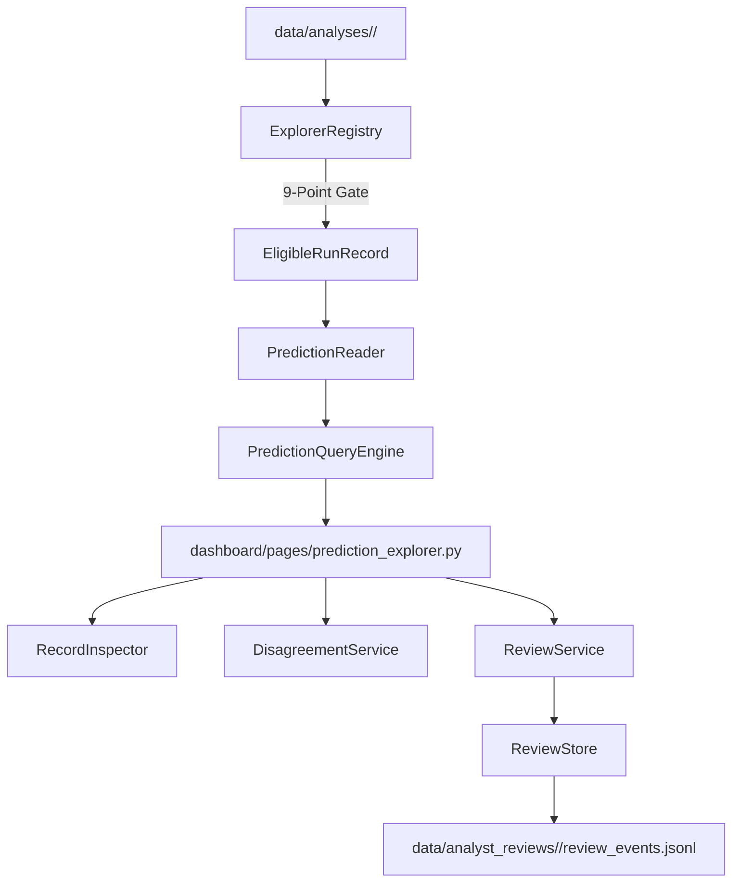

# CP-09 — Prediction Explorer & Analyst Review Engineering Report

**Project:** AI-Powered Network Intrusion Detection System (NIDS)  
**Checkpoint:** CP-09 — Prediction Explorer & Analyst Review  
**Accepted Baseline Commit:** `1e44e60`  
**Test Suite Status:** 218 / 218 tests passing (100% pass rate, 0 regressions)  
**Timestamp:** 2026-11-18  

---

## 1. Executive Summary

Checkpoint **CP-09 (Prediction Explorer & Analyst Review)** introduces a forensic analysis and human-in-the-loop analyst review subsystem into the AI-Powered NIDS platform. Operating as a strictly read-only consumer of completed CP-08 detection artifacts, CP-09 enables cybersecurity analysts to:

1. Browse and discover completed production detection runs via a 9-point cryptographic and governance gate.
2. Filter, search, and sort classified network flows across attack classes, agreement states, review statuses, and model families.
3. Perform deep forensic inspection of individual network traffic records, including network attributes, per-model decisions, and algorithm-specific score semantics.
4. Explore cross-model consensus and divergence patterns without introducing unauthorized ensembles or majority-voting meta-models.
5. Manually evaluate flows and assign explicit human analyst dispositions (`Potentially Malicious`, `Likely Benign`, `False Positive`, `Needs Further Investigation`, `Inconclusive`).
6. Persist an immutable, append-only review event journal under `data/analyst_reviews/<run_id>/` with tamper-evident cryptographic hash chaining, preserving zero mutation of original CP-08 detection artifacts.

---

## 2. Repository Reconnaissance Findings

Reconnaissance confirmed the following architectural properties:
- **Git Baseline:** Clean working tree on branch `master` at commit `1e44e60`.
- **CP-08 Artifact Schema:** `predictions.csv` stores rows with `source_row_index`, single-model predictions (`predicted_class`, `model_score`, `score_type`) or multi-model predictions (`{algo}_prediction`, `{algo}_score`, `agreement_status`, `differing_models`), and optional `ground_truth_label`.
- **Artifact Immutability:** CP-08 artifacts are stored under `data/analyses/<run_id>/`. In CP-09, analyst reviews are stored strictly isolated in `data/analyst_reviews/<run_id>/`.
- **Navigation Wiring:** `dashboard/navigation.py` already routes to `dashboard.pages.prediction_explorer`.

---

## 3. Architecture & Subsystem Design

The subsystem is implemented under `src/explorer/` with business logic completely decoupled from UI code:



---

## 4. Files Created and Modified

### Files Created:
1. `src/explorer/review_models.py` — Dataclasses for `ReviewEvent`, `ReviewSummary`, and `AnalystDisposition` enums.
2. `src/explorer/review_store.py` — Append-only persistence, per-run thread safety, duplicate protection, and cryptographic hash chaining.
3. `src/explorer/explorer_registry.py` — 9-point verification check for completed detection runs.
4. `src/explorer/prediction_reader.py` — Cached reading of `predictions.csv` with path-traversal validation and live review state joining.
5. `src/explorer/prediction_query.py` — Multi-attribute filtering, substring search, triage sorting, and bounded pagination.
6. `src/explorer/record_inspector.py` — Forensic record inspection, raw attribute extraction from CSV, and score explanations.
7. `src/explorer/disagreement_service.py` — Multi-model consensus analytics, pairwise agreement matrices, and divergence patterns.
8. `src/explorer/review_service.py` — High-level service orchestrator for review workflows and audit verification.
9. `src/explorer/__init__.py` — Package export definitions.
10. `tests/explorer/__init__.py` — Test package definitions.
11. `tests/explorer/test_prediction_explorer.py` — Exhaustive 38-test verification suite covering Categories A through H.
12. `docs/CP09_PREDICTION_EXPLORER.md` — Subsystem architecture and user documentation.
13. `docs/CP09_Prediction_Explorer_Report.md` — This engineering verification report.
14. `data/analyst_reviews/.gitkeep` — Directory preservation.

### Files Modified:
1. `config/settings.py` — Added `ANALYST_REVIEWS_DIR`, updated `AppConfig` and `ensure_directories()`.
2. `.gitignore` — Added `data/analyst_reviews/*` and `!data/analyst_reviews/.gitkeep`.
3. `dashboard/pages/prediction_explorer.py` — Implemented Sections A through F of the interactive console.

---

## 5. CP-08 Integration & Zero-Mutation Invariant

CP-09 strictly treats CP-08 as an immutable upstream dependency:
- **Zero Retraining or Inferences:** No models are fitted, retrained, or evaluated during exploration.
- **Artifact Non-Mutation:** SHA-256 hashes of `predictions.csv`, `model_comparison.csv`, and `run_manifest.json` remain identical before and after all review operations, verified explicitly by automated tests (`test_zero_mutation_of_cp08_artifacts`).

---

## 6. Prediction Explorer UI Functionality

The interactive Streamlit interface in `dashboard/pages/prediction_explorer.py` features:
- **Section A (Detection Run Selector):** Dropdown of verified eligible runs with provenance details.
- **Section B (Prediction Telemetry & Review Progress):** KPI metric cards (Total Flows, Evaluated Models, Agreement Rate, Disagreement Rate, Analyst Review Progress).
- **Section C (Prediction & Review Visualizations):** 3 Plotly charts (Predicted Class Distribution, Consensus vs Divergence donut chart, Analyst Dispositions distribution).
- **Section D (Filtering & Records Table):** Multi-attribute filters, substring search, triage sorting ("Disagreements First"), bounded pagination, and responsive DataFrame view.
- **Section E (Forensic Record Inspector):** Tabbed interface for selected flows:
  - Tab 1: Raw network flow attributes from source CSV.
  - Tab 2: Side-by-side model predictions and algorithm-specific score semantics.
  - Tab 3: Dataset ground truth reference clearly marked as academic benchmark data.
  - Tab 4: Analyst review submission form and chronological audit trail.
- **Section F (Model Disagreement Explorer):** Pairwise agreement percentage matrix, top divergence patterns, and forensic triage guidance.

---

## 7. Model Score Semantics & Decision Transparency

Score semantics are strictly preserved according to algorithm mathematical properties:
- **LinearSVC (SVM):** Signed Euclidean distance to separating hyperplane (`decision_function`). Class assignment determined by maximum margin. Scores are uncalibrated distances.
- **MLPClassifier (MLP):** Softmax activation output. Heuristic uncalibrated activation confidence; not a true Bayesian posterior probability.
- **DecisionTreeClassifier (DT):** Class frequency proportion at terminal leaf node. Discrete frequency heuristic; not a calibrated probability.

---

## 8. Test Suite Verification & Quality Gates

The test suite was expanded with 38 dedicated unit and integration tests under `tests/explorer/`:

```
Test Categories Covered:
├── Category A: Detection Run Discovery & Eligibility Gating (6 tests)
├── Category B: Prediction Reading & Schema Compatibility (4 tests)
├── Category C: Multi-Attribute Filtering, Sorting & Pagination (9 tests)
├── Category D: Individual Record Inspection & Network Telemetry (4 tests)
├── Category E: Model Consensus & Disagreement Exploration (3 tests)
├── Category F: Human Analyst Review Workflow (6 tests)
├── Category G: Audit Trail, Cryptographic Hash Chain & Zero Mutation (4 tests)
└── Category H: Dashboard Integration & UI Rendering (2 tests)
```

### Full Regression Test Results:
- **Prior Passing Baseline (CP-08):** 180 tests
- **New CP-09 Tests:** 38 tests
- **Total Passing Tests:** **218 tests**
- **Test Failures:** **0**
- **Regressions:** **0**
- **Execution Time:** ~12.2 seconds

---

## 9. Security Audit Findings

1. **Path Traversal Protection:** All directory lookups in `ExplorerRegistry`, `PredictionReader`, `ReviewStore`, and `RecordInspector` enforce resolved path boundary checks, rejecting directory traversal attempts (`test_path_traversal_protection`).
2. **Cryptographic Tamper-Evidence:** Review journals use sequential SHA-256 hash chaining. Altering previous entries breaks the chain and is immediately detected (`test_tampered_journal_hash_chain_detection`).
3. **Fixture Isolation:** Automated test fixtures are strictly prevented from appearing in production run catalogs (`test_fixture_isolation`).
4. **Input Sanitization:** Analyst notes are bounded to 2000 characters and reviewer labels have control characters stripped.

---

## 10. Conclusion & Next Checkpoint Readiness

Checkpoint CP-09 is complete, verified, and ready for baseline commit. No work on Checkpoint CP-10 (Threat Intelligence & Attack Context) will begin without explicit user instruction.
