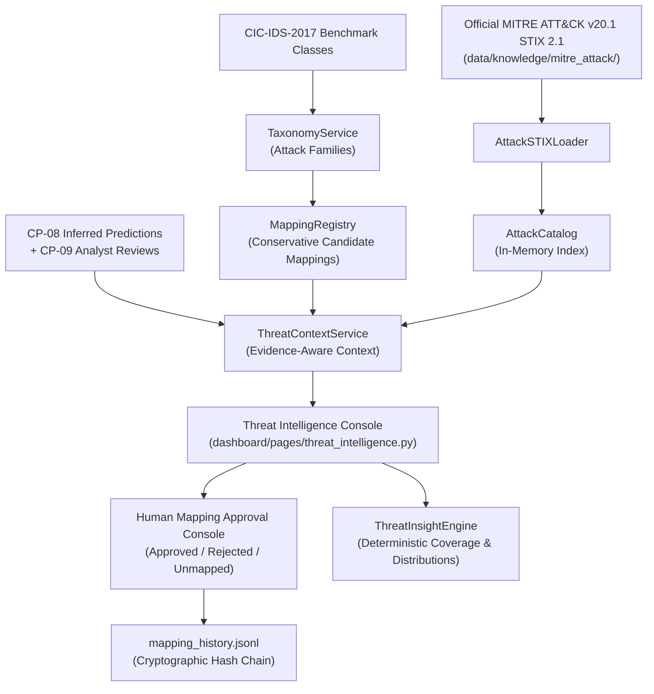

# Checkpoint CP-10 — Threat Intelligence & Attack Context

**Subsystem:** Threat Intelligence & Attack Context  
**Milestone:** CP-10  
**Status:** Completed & Cryptographically Verified  
**Baseline Commit:** `f2a6ec2`  
**Test Suite:** 242 / 242 tests passing (100% pass rate, 0 regressions)  

---

## 1. Official MITRE ATT&CK Attribution & Disclaimer

> **Attribution Notice:**  
> "© 2026 The MITRE Corporation. This work is reproduced and distributed with the permission of The MITRE Corporation."

> **Trademark & Endorsement Disclaimer:**  
> "MITRE ATT&CK is a registered trademark of The MITRE Corporation. MITRE does not endorse or certify this project."

Official Repository: `https://github.com/mitre-attack/attack-stix-data`  
Official Release: **MITRE ATT&CK Enterprise v20.1** (Release Date: November 5, 2026)  
STIX Specification: **STIX 2.1**  

---

## 2. Subsystem Architecture

Checkpoint CP-10 introduces a structured threat-intelligence and contextual enrichment subsystem to the AI-Powered Network Intrusion Detection System (NIDS). Built as an offline-first knowledge framework, CP-10 links actual machine learning predictions (LinearSVC, MLPClassifier, DecisionTreeClassifier) to verified MITRE ATT&CK Enterprise techniques, tactics, mitigations, and evidence evaluations without cloud dependencies, external AI APIs, or unverified attribution claims.

---

## 3. Core Modules (`src/threat_intelligence/`)

| Module | Core Responsibility |
|---|---|
| `attack_models.py` | Data structures for `Tactic`, `Technique`, `Mitigation`, `AttackBundleMetadata`, `AttackFamily`, `LabelTechniqueMapping`, `MappingReviewEvent`, and `EnrichedAttackContext`. |
| `attack_catalog.py` | In-memory indexing, search, filtering, and cross-object relationship traversal (`Techniques -> Mitigations`). |
| `attack_stix_loader.py` | Parses and validates official STIX 2.1 JSON bundles, verifying types, version, and SHA-256 checksums. |
| `reference_registry.py` | Manages local storage in `data/knowledge/mitre_attack/`, atomic staging via `.tmp` files, and thread-safe caching. |
| `taxonomy_service.py` | Normalizes dataset attack labels and categorizes them into broad threat families (`Denial of Service`, `Brute Force`, `Port Scanning`, etc.). |
| `mapping_registry.py` | Stores persistent candidate mappings in `data/knowledge/mappings/` and enforces human approval workflows with hash chaining. |
| `context_service.py` | Enriches prediction records with candidate ATT&CK techniques, available network flow evidence, missing evidence, and forensic disclaimers. |
| `insight_engine.py` | Calculates deterministic coverage metrics, family distributions, and disagreement cross-tabulations without fabricated severity scores. |

---

## 4. Dataset Attack Label Taxonomy & Threat Families

The 15 benchmark CIC-IDS-2017 classes are categorized into standardized cybersecurity threat families:

| Dataset Attack Class | Threat Family | Description |
|---|---|---|
| **BENIGN** | `Benign` | Normal baseline enterprise network traffic. |
| **PortScan** | `Port Scanning` | Systematic probe packets across sequential ports to discover listening services. |
| **DoS Hulk** | `Denial of Service` | Volumetric HTTP GET flooding designed to exhaust web server capacity. |
| **DoS GoldenEye** | `Denial of Service` | Application-layer DoS exploiting HTTP Keep-Alive persistent connection exhaustion. |
| **DoS slowloris** | `Denial of Service` | Low-and-slow HTTP header starvation holding socket connections open. |
| **DoS Slowhttptest** | `Denial of Service` | Slow read/slow body HTTP requests draining server connection pools. |
| **DDoS** | `Distributed Denial of Service` | High-volume coordinated multi-source flooding targeting bandwidth saturation. |
| **FTP-Patator** | `Brute Force` | Multi-threaded automated dictionary password guessing against FTP (TCP 21). |
| **SSH-Patator** | `Brute Force` | Multi-threaded automated dictionary password guessing against SSH (TCP 22). |
| **Web Attack - Brute Force** | `Brute Force` | Automated credential stuffing targeting web application login forms. |
| **Web Attack - Sql Injection** | `Web Attack` | SQL command injection via vulnerable web parameters to manipulate backend queries. |
| **Web Attack - XSS** | `Web Attack` | Cross-Site Scripting injecting client-side scripts into victims' browsers. |
| **Heartbleed** | `Exploitation` | Exploitation of OpenSSL TLS Heartbeat memory disclosure vulnerability (CVE-2014-0160). |
| **Bot** | `Bot Activity` | Automated malware agent communicating with command-and-control infrastructure. |
| **Infiltration** | `Infiltration` | Multi-stage internal host compromise and lateral reconnaissance. |

---

## 5. Conservative Candidate Mappings & Evidence Alignment

A dataset class classification is **never** automatically treated as a verified real-world ATT&CK technique. CP-10 defines explicit conservative candidate mappings with documented evidence requirements:

| Dataset Label | Candidate ATT&CK Reference | Tactic | Alignment Strength | Required vs Missing Evidence |
|---|---|---|---|---|
| **PortScan** | **T1046 — Network Service Discovery** | Discovery | Direct behavior alignment | Available: destination port ranges, flow rate. Missing: target socket response, process name. |
| **FTP-Patator** | **T1110 — Brute Force** | Credential Access | Conditional behavior alignment | Available: repeated port 21 connections. Missing: FTP 530 error codes, credential dictionary strings. |
| **SSH-Patator** | **T1110 — Brute Force** | Credential Access | Conditional behavior alignment | Available: repeated port 22 connections. Missing: SSH auth.log events, decrypted payload. |
| **Web Attack - Brute Force** | **T1110 — Brute Force** | Credential Access | Conditional behavior alignment | Available: port 80/443 traffic, high flow frequency. Missing: HTTP POST body credentials, 401/403 status responses. |
| **DoS Families (Hulk, GoldenEye, slowloris, Slowhttptest, DDoS)** | **T1498 — Network Denial of Service** | Impact | Broad contextual association | Available: asymmetric packet volume, high flow rates. Missing: target CPU/RAM exhaustion, service disruption confirmation. |
| **Web Attack - Sql Injection** | **T1190 — Exploit Public-Facing Application** | Initial Access | Conditional behavior alignment | Available: port 80/443 traffic. Missing: unencrypted SQL payload strings, backend database logs. |
| **Heartbleed** | **T1190 — Exploit Public-Facing Application** | Initial Access | Broad contextual association | Available: port 443 TCP traffic. Missing: decrypted TLS Heartbeat bytes, memory disclosure logs. |
| **Web Attack - XSS** | *Unmapped* | Initial Access | Insufficient evidence | Netflow telemetry lacks client-side DOM execution events or response payload inspection. |
| **Bot** | *Unmapped* | Command & Control | Insufficient evidence | Broad label; netflow lacks C2 domain DNS telemetry or process execution trees. |
| **Infiltration** | *Unmapped* | Lateral Movement | Insufficient evidence | Multi-stage intrusion; single network flow lacks host post-exploitation telemetry. |
| **BENIGN** | *Unmapped* | None | Insufficient evidence | Normal traffic does not map to an adversary ATT&CK technique. |

---

## 6. Human Mapping Review Workflow & Cryptographic Audit Trail

Analysts can explicitly approve, reject, or mark mappings as unmapped:
1. Approvals are strictly **human-initiated**. Model predictions or CP-09 analyst reviews never automatically approve technique mappings.
2. Changes are appended to `data/knowledge/mappings/mapping_history.jsonl` with sequential SHA-256 hash chaining:
   $$H_i = \text{SHA-256}\Big(\text{Event}_i \,\|\, H_{i-1}\Big)$$
3. **CP-08 / CP-09 Invariant:** Mapping modifications **never** mutate original prediction artifacts or analyst dispositions.

---

## 7. Deterministic Security Insights

The insight engine computes verifiable metrics without fabricated risk scores:
- **ATT&CK Mapping Coverage:** Percentages of mapped, approved, reviewed, and unmapped classes.
- **Attack Family Distribution:** Aggregate record counts grouped by threat family.
- **Model Disagreement by Attack Class:** Cross-tabulates model consensus against predicted attack categories.
- **Strict Non-Attribution:** No fabricated threat actor likelihoods, campaign attributions, or artificial severity ratings.

---

## 8. How to Use the Threat Intelligence Console

1. Navigate to **🌐 Threat Intelligence** in the application sidebar.
2. Review the **Overview** telemetry card and MITRE attribution notice.
3. In **📚 Attack Taxonomy**, inspect standardized definitions and filter by threat family.
4. In **🔍 ATT&CK Explorer**, search techniques by ID (e.g. `T1046`), name, or tactic, and inspect associated defensive mitigations.
5. In **🎯 Label-to-Technique Mappings**, review candidate mappings, examine required vs missing evidence, and execute manual approval/rejection actions.
6. In **🔬 Contextual Predictions**, select a completed detection run from CP-08 to inspect individual flows enriched with ATT&CK context, available flow evidence, missing payload telemetry, and mitigation recommendations.
7. In **📊 Security Insights**, review deterministic class coverage and threat family charts.
8. In **⚙️ Reference Management**, inspect installed STIX bundle provenance (v20.1, SHA-256) or import newer local official snapshots.
