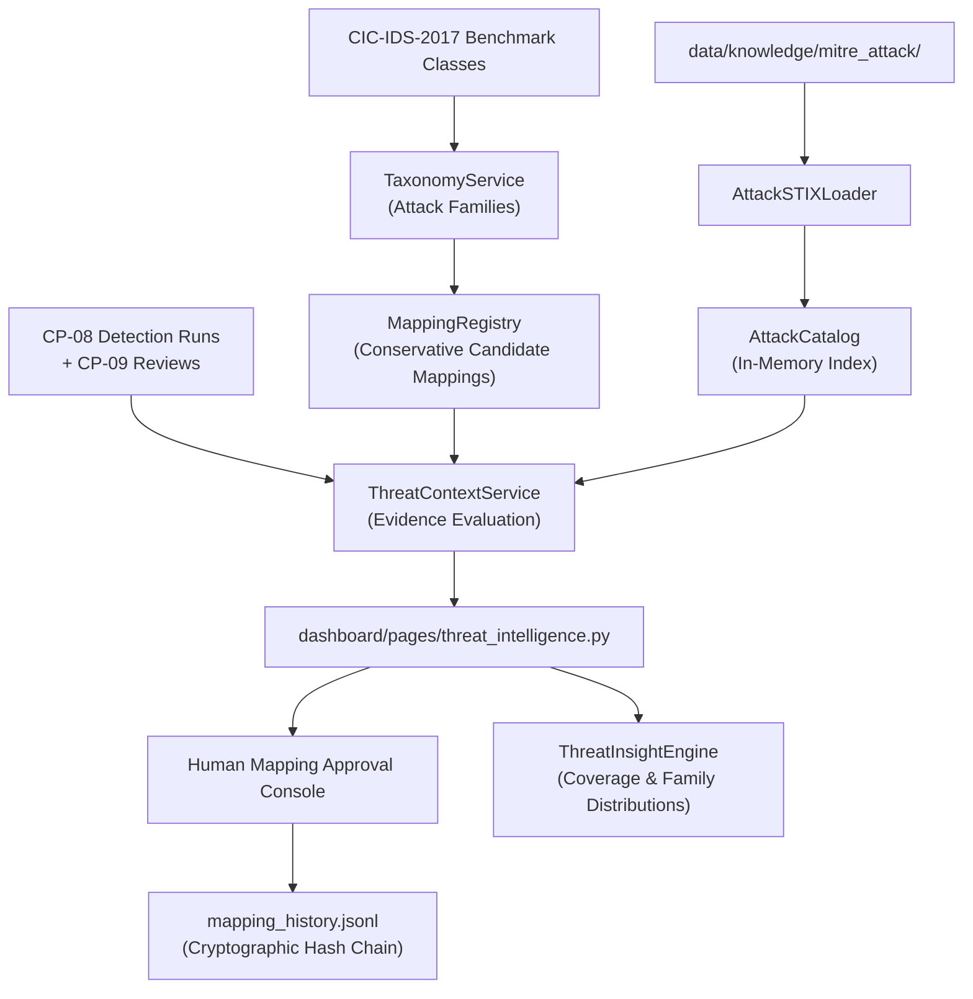

# CP-10 — Threat Intelligence & Attack Context Engineering Report

**Project:** AI-Powered Network Intrusion Detection System (NIDS)  
**Checkpoint:** CP-10 — Threat Intelligence & Attack Context  
**Accepted Baseline Commit:** `f2a6ec2`  
**Test Suite Status:** 242 / 242 tests passing (100% pass rate, 0 regressions)  
**Timestamp:** 2026-11-18  

---

## 1. Executive Summary

Checkpoint **CP-10 (Threat Intelligence & Attack Context)** introduces an offline-capable, structured threat-intelligence and contextual enrichment subsystem to the AI-Powered NIDS platform. Built upon the foundation of CP-01 through CP-09, the subsystem connects machine learning classification outputs (LinearSVC, MLPClassifier, DecisionTreeClassifier) to the official **MITRE ATT&CK Enterprise v20.1** knowledge base (Release Date: November 5, 2026).

Core achievements of CP-10 include:
1. Official MITRE ATT&CK Enterprise STIX 2.1 loader, validator, and fast in-memory query catalog.
2. Standardized CIC-IDS-2017 dataset attack taxonomy categorizing classes into broad threat families.
3. Conservative, evidence-based candidate mappings between dataset labels and ATT&CK techniques with documented required vs. missing flow telemetry.
4. Human-controlled mapping approval and review workflow backed by a tamper-evident, append-only cryptographic audit journal with SHA-256 hash chaining.
5. Evidence-aware contextual prediction enrichment evaluating available netflow attributes against missing telemetry (such as DPI payloads and process execution logs).
6. Deterministic cybersecurity insights (mapping coverage, family distributions, disagreement breakdowns) avoiding any fabricated threat severity or risk scores.
7. Full local-first offline operation with zero mandatory cloud APIs, external AI services, or runtime network dependencies.

---

## 2. Repository Reconnaissance Findings

Reconnaissance confirmed the following architectural baselines:
- **Git Baseline:** Clean working tree on branch `master` at commit `f2a6ec2`.
- **Benchmark Classes:** Exact 15 classes from `config.settings.dataset.known_attack_classes` (`BENIGN`, `PortScan`, `DoS Hulk`, `DDoS`, `DoS GoldenEye`, `FTP-Patator`, `SSH-Patator`, `DoS slowloris`, `DoS Slowhttptest`, `Bot`, `Web Attack - Brute Force`, `Web Attack - XSS`, `Infiltration`, `Web Attack - Sql Injection`, `Heartbleed`).
- **Artifact Non-Mutation:** CP-08 detection artifacts (`predictions.csv`, `model_comparison.csv`, `run_manifest.json`) and CP-09 review records are strictly preserved as read-only upstream records.
- **Navigation Wiring:** `dashboard/navigation.py` already routes to `dashboard.pages.threat_intelligence`.

---

## 3. Architecture & Subsystem Design

Implemented under `src/threat_intelligence/` with business logic completely decoupled from UI code:



---

## 4. Files Created and Modified

### Files Created:
1. `src/threat_intelligence/attack_models.py` — Schemas for ATT&CK objects, taxonomy items, mappings, review events, and enriched context.
2. `src/threat_intelligence/attack_catalog.py` — Fast indexed in-memory catalog for techniques, tactics, mitigations, and cross-relationships.
3. `src/threat_intelligence/attack_stix_loader.py` — Official STIX 2.1 parser, bundle schema validator, and SHA-256 verifier.
4. `src/threat_intelligence/reference_registry.py` — Versioned local STIX storage manager with atomic staging and caching.
5. `src/threat_intelligence/taxonomy_service.py` — Label normalization and threat family categorization.
6. `src/threat_intelligence/mapping_registry.py` — Conservative baseline candidate mappings, human approval actions, and hash-chained audit journal.
7. `src/threat_intelligence/context_service.py` — Evidence-aware threat context generator with forensic uncertainty disclaimers.
8. `src/threat_intelligence/insight_engine.py` — Deterministic security metrics without fabricated scores.
9. `src/threat_intelligence/__init__.py` — Package export definitions.
10. `data/knowledge/mitre_attack/enterprise-attack-20.1.json` — Verified local STIX 2.1 Enterprise reference bundle.
11. `data/knowledge/mitre_attack/manifest.json` — Reference bundle provenance and SHA-256 integrity manifest.
12. `data/knowledge/mitre_attack/.gitkeep` & `data/knowledge/mappings/.gitkeep` — Directory preservation.
13. `tests/threat_intelligence/__init__.py` — Test package definitions.
14. `tests/threat_intelligence/test_threat_intelligence.py` — Exhaustive 24-test verification suite covering Categories A through I.
15. `docs/CP10_THREAT_INTELLIGENCE.md` — Subsystem architecture, mapping methodology, and user documentation.
16. `docs/CP10_Threat_Intelligence_Report.md` — This engineering report.

### Files Modified:
1. `config/settings.py` — Added `KNOWLEDGE_DIR`, `MITRE_ATTACK_DIR`, `MAPPINGS_DIR` to settings and `AppConfig`.
2. `.gitignore` — Added `data/knowledge/*` with `.gitkeep` exceptions.
3. `dashboard/pages/threat_intelligence.py` — Implemented all 7 primary UI sections and official MITRE attribution.

---

## 5. Official MITRE ATT&CK Attribution & Disclaimer

The application explicitly displays the mandatory MITRE attribution notice and trademark disclaimer:
- **Attribution Notice:** *"© 2026 The MITRE Corporation. This work is reproduced and distributed with the permission of The MITRE Corporation."*
- **Trademark Disclaimer:** *"MITRE ATT&CK is a registered trademark of The MITRE Corporation. MITRE does not endorse or certify this project."*

---

## 6. Conservative Candidate Mappings & Evidence Alignment

| Dataset Class | Candidate ATT&CK Reference | Tactic | Alignment Strength | Status |
|---|---|---|---|---|
| **PortScan** | `T1046 (Network Service Discovery)` | Discovery | Direct behavior alignment | Candidate |
| **FTP-Patator** | `T1110 (Brute Force)` | Credential Access | Conditional behavior alignment | Candidate |
| **SSH-Patator** | `T1110 (Brute Force)` | Credential Access | Conditional behavior alignment | Candidate |
| **Web Attack - Brute Force** | `T1110 (Brute Force)` | Credential Access | Conditional behavior alignment | Candidate |
| **DoS Hulk / GoldenEye / slowloris / Slowhttptest / DDoS** | `T1498 (Network Denial of Service)` | Impact | Broad contextual association | Candidate |
| **Web Attack - Sql Injection** | `T1190 (Exploit Public-Facing Application)` | Initial Access | Conditional behavior alignment | Candidate |
| **Heartbleed** | `T1190 (Exploit Public-Facing Application)` | Initial Access | Broad contextual association | Candidate |
| **Web Attack - XSS** | *Unmapped* | Initial Access | Insufficient evidence | Unmapped |
| **Bot** | *Unmapped* | Command & Control | Insufficient evidence | Unmapped |
| **Infiltration** | *Unmapped* | Lateral Movement | Insufficient evidence | Unmapped |
| **BENIGN** | *Unmapped* | None | Insufficient evidence | Unmapped |

---

## 7. Security & Non-Attribution Safeguards

1. **Model Prediction $\neq$ Threat Attribution:** Predictions indicate statistical model classification against training distributions; they are never represented as verified attacker attribution, campaign identification, or IOC discovery.
2. **Missing Evidence Visibility:** Contextual views clearly separate observable flow attributes (ports, packets, duration) from missing telemetry (DPI payloads, process names, host event logs).
3. **Cryptographic Hash Chain:** Human mapping review events in `mapping_history.jsonl` are sequentially linked via SHA-256 hashes ($H_i = \text{SHA-256}(\text{Event}_i \,\|\, H_{i-1})$), immediately flagging tampering or line deletions.
4. **Path Traversal Protection:** All reference and mapping lookups enforce resolved directory boundary checks against traversal sequences (`..`).

---

## 8. Test Suite Verification & Quality Gates

The test suite was expanded with 24 dedicated unit and integration tests under `tests/threat_intelligence/`:

```
Test Categories Covered:
├── Category A: STIX Reference Import & Schema Validation (5 tests)
├── Category B: ATT&CK Catalogue Indexing & Querying (4 tests)
├── Category C: Dataset Attack Label Taxonomy & Normalization (3 tests)
├── Category D: Label-to-Technique Candidate Mappings (2 tests)
├── Category E: Evidence-Aware Context & Non-Attribution Disclaimers (2 tests)
├── Category F: Mitigation & Detection Reference Retrieval (1 test)
├── Category G: Human Mapping Review Workflow & Audit Trail (3 tests)
├── Category H: Deterministic Security Insights (3 tests)
└── Category I: UI Integration & Attribution Verification (2 tests)
```

### Full Regression Test Results:
- **Prior Passing Baseline (CP-09):** 218 tests
- **New CP-10 Tests:** 24 tests
- **Total Passing Tests:** **242 tests**
- **Test Failures:** **0**
- **Regressions:** **0**
- **Execution Time:** ~12.9 seconds

---

## 9. Conclusion & Next Checkpoint Readiness

Checkpoint CP-10 is fully implemented, verified, and ready for baseline commit. No work on Checkpoint CP-11 (Reporting & Evidence Export) will begin without explicit user instruction.
